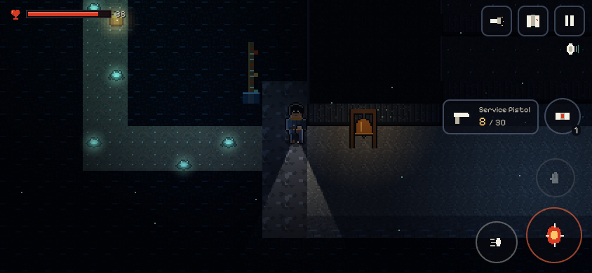

# The World Below

A pixel-art exploration survival shooter for the browser, designed first for **landscape iPhone Safari**, with keyboard and mouse supported too. Beautiful mystery above, frightening depths below, and muzzle flashes that light up the room you're in.

**Status: M0–M3 plus a world-structure pass.**
- **The opening slice.** Home, the rainy street, the laundrette, the service tunnels, the pumping gallery and the Pipeworks mini-boss. It opens onto a **persistent generated frontier**.
- **Optional depths.** Below it all lie **Bracken Underground's Last Platform** (several ways in) and an **underground sea** governed by the tide. Beyond them is a colossal door that leads somewhere you already know.
- **Objectives come from evidence.** The journal holds questions and observations, with optional hints.

See [PROGRESS.md](PROGRESS.md) for what's verified and what isn't, and [docs/WORLD_STRUCTURE.md](docs/WORLD_STRUCTURE.md) for the route graph.




## Run it

```bash
npm ci
npm run dev          # http://localhost:5173 (also reachable from a phone on the same network)
npm run build        # static production build in dist/
npx vite preview     # serve the production build on http://localhost:4173
```

Requires Node ≥ 22.18. The build is fully static and uses relative asset paths, so `dist/` works from any HTTPS host or sub-path (e.g. GitHub Pages). It needs no API keys, accounts or backend.

## Controls

| Action | Touch (landscape) | Keyboard / mouse |
|---|---|---|
| Move | Left thumb anywhere on the left half (floating stick) | WASD / arrows |
| Fire | Hold the big FIRE button (aims for you) | Hold left mouse button |
| Manual aim | Drag away from FIRE while holding | Mouse |
| Dodge | Footprint button | Space |
| Interact | Hand button (lights up when something is in reach) | E |
| Heal | Bandage button | Q |
| Switch weapon | Tap the weapon panel | 1 / 2 / mouse wheel |
| Torch on/off | Torch button (top right) | F |
| Reload | Automatic when empty or idle | R |
| Map / Journal / Pause | Top-right buttons | M or Tab / J / Esc |

Settings include: aim assist, left-handed layout, control and text size, reduced flash/shake/motion, high-contrast threat warnings, visual sound cues, gentle death, and volume.

## Scripts

| Script | Purpose |
|---|---|
| `npm run typecheck` | Strict TypeScript |
| `npm run lint` | ESLint |
| `npm run test` | Vitest: simulation, saves, light visibility, content validation |
| `npm run validate:content` | Content validation only: IDs, references, reachability, fair secrets, atlas frames |
| `npm run art` | Regenerate all pixel art from `tools/art` into `public/assets` |
| `npm run smoke [-- URL]` | Playwright browser run of the slice plus the generated frontier (44 checks; screenshots go to `captures/smoke/`) |
| `npm run smoke:world [-- URL]` | Playwright run of the world-structure pass: both Platform Zero approaches, the tide, Edda's cellar, every shortcut, journal hints, save/reload (40 checks; `captures/smoke-world/`) |

## Repository map

- `src/` — the game ([docs/ARCHITECTURE.md](docs/ARCHITECTURE.md) explains how it's organised and why).
- `tools/art/` — authored pixel art as code: tiles, characters, props, FX and icons (see [docs/ASSETS.md](docs/ASSETS.md)).
- `docs/design/` — the original design pack, unmodified.
- [docs/CHARTER_AND_VISUAL_TARGET.md](docs/CHARTER_AND_VISUAL_TARGET.md) — one-page charter and the visual target room.
- `tests/`, `tools/smoke.mjs` — automated checks.
