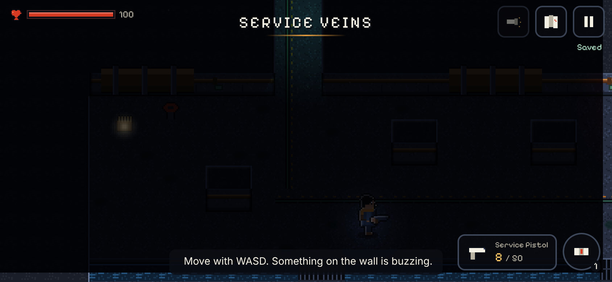
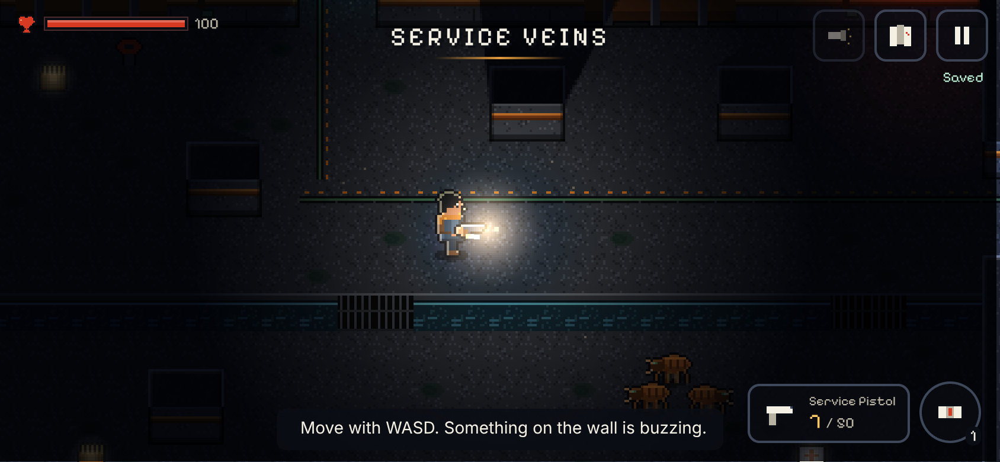

# Charter and visual target

## One-page charter
**Promise:** ordinary places lead somewhere extraordinary. A small, capable explorer follows an impossible intercom call beneath a rainy street and finds the world keeps exceeding their understanding.

**Core loop in this slice:** prepare at a refuge → follow a clue (amber cable markings, a card, an airflow diagram) → navigate and fight → discover something meaningful (a sealed gallery, a mini-boss, a lens) → open a return route (the service lift) and keep the knowledge (journal and map).

**Pillars:**
1. **Beautiful uncertainty:** each room has its own palette, a quiet animation (washers, pumps, fan, rain, lint) and something unexplained (the balcony you can't reach).
2. **Persistent discovery:** doors, the hatch, the panel, lamps, defeated unique enemies, pickups, the map and the journal survive death and reload.
3. **Simple action, deep decisions:** move, fire (assisted or manual), dodge and interact. The torch-versus-leech trade-off and cover-versus-hose positioning come from the systems, not from extra buttons.

**The defining sensory event:** a gunshot briefly lights more room than you knew was there. The light is clipped to what the muzzle can actually see.

**Out of scope:** multiplayer, base building, hunger/thirst, destructible terrain, runtime AI, monetisation.

## Visual target room: the Cistern Hall (Service Veins)
The darkest room in the slice, chosen because it tests every visual rule at once.

| Before the shot (torch off) | One frame after a pistol shot |
|---|---|
|  |  |

What it demonstrates:
- **Readable ambient floor.** Wall rims, the green-cable route and pickups stay legible in the dark.
- **Room-revealing flash.** The muzzle flash lights the hall, casts hard shadows behind pillars, and reveals the Skitters waiting across the water channel. It never crosses the wall into the corridor above.
- **Crisp sprites under smooth light.** Art pixels stay sharp because the light mask multiplies over them.
- **Colour roles.** Slate and teal for structure, amber for human warmth (scarf, refuge lamp, cable paint), mint for machinery, vermilion only for danger.

Other reference frames are in `docs/screenshots/`: street, laundrette, refuge booth, humming wall, Pipekeeper, relay, death, touch.
