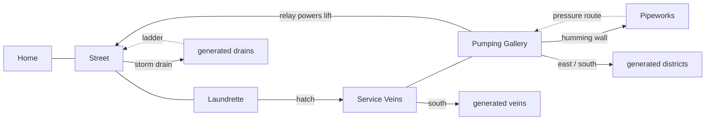
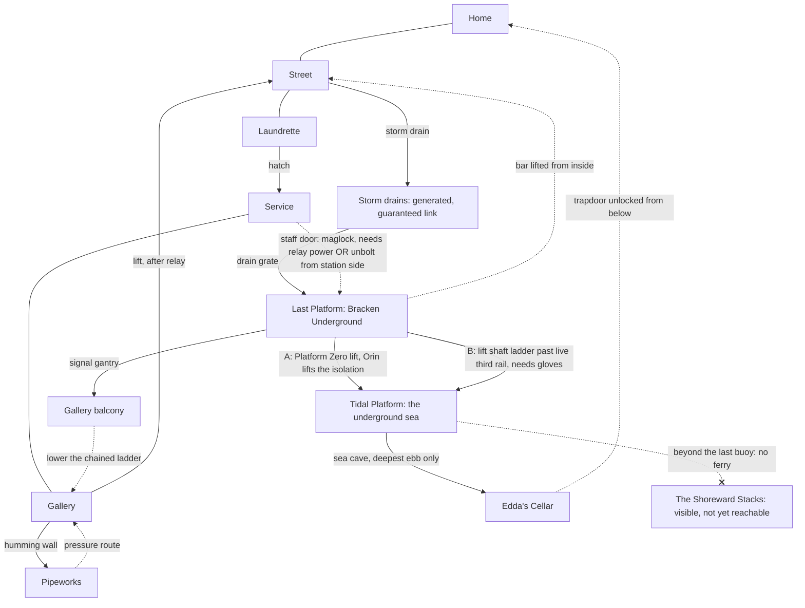

# World structure: why it felt linear, and the network that replaces it

## 1. Diagnosis of the M0–M3 build

| Cause | Where it showed | Effect |
|---|---|---|
| **Instructional information** | Mara's first call names the place ("under the laundrette"), the route ("follow the amber cable markings") and the action ("reconnect it"). The shelf card says exactly how to open the hatch. The relay call says "the lift runs to the street now, go home". Journal entries were quest steps ("Lead: …"). The pause screen restated the next step. | Players never had to *notice* anything. Every interaction handed over the next step. |
| **Single critical chain** | home → street → yard → laundrette → hatch → Service Veins → gallery → relay → lift → home. Every authored region had exactly one way in from the previous one. | Nothing to choose. The world was a corridor with rooms. |
| **Branches were small loot stubs** | The only authored branch was the humming wall (a good secret, but one room deep). | Optional paths read as "chest after thirty seconds". |
| **Visible things with no payoff** | The gallery balcony was visible but connected to nothing. | A promise the world did not keep. |
| **Generated frontier had breadth but no purpose** | Districts branched deeper but never reconnected to known places, and nothing in the authored world pointed into them. | Exploration without investigation: more corridors, not more meaning. |
| **No change of scale** | Every place was a tunnel of human-sized rooms. | Nothing for "deeper" to mean except darker. |

## 2. Route graph before this pass

## 3. Expanded graph (implemented in this pass)

Solid arrows are first-time routes; dotted arrows open from the far side and become shortcuts.

### How each new connection works

| Connection | Kind of gate | What the player sees first | How it opens |
|---|---|---|---|
| Street ↔ Bracken Underground entrance | opened from the far side | A boarded station entrance with old tiles: BRACKEN UNDERGROUND | Lift the bar inside the ticket hall |
| Service Veins ↔ station staff door | environmental (power) **or** far side | A dark maglock lamp on a STAFF ONLY door | Reconnecting the relay powers the lock and it releases; or open the manual release from inside the station |
| Storm drains → station track tunnel | maintenance route | Water running toward a grate in the first storm-drain district (always generated with this link) | Walk through. It is the dangerous early way in |
| Station ↔ gallery balcony | far side | The balcony visible from the gallery since the start; a chained ladder | Walk from the signal gantry onto the balcony; lower the ladder |
| Station → Tidal Platform | **social / knowledge** (A) or **tool + danger** (B) | A motionless lift, an announcement for "platform zero", a dead SECTION 9 call panel, a powered signal cabin | A: persuade Orin Vale to lift the isolation (evidence: Mara on his radio once the relay is live, or Edda's signed rota). B: disconnect the live third rail with the gloves and climb down the dark shaft |
| Tidal Platform → Edda's Cellar → Home | environmental (tide) + far side | A sea cave at the foot of a colossal door, underwater except at the deepest ebb | The tide rule: every third ebb drains the deep causeway; the cellar's stair unlocks the home trapdoor from below |

## 4. Design rules this structure follows

- **Never the only clue behind its own gate.** Every gate's evidence is visible from the side you meet it on (lamp, chain, plaque, announcement, crabs, tide gauge).
- **Different approaches, different consequences.**
  - Taking route A powers the station: lights, live announcements, a working lift both ways, and Orin as an ally.
  - Taking route B leaves the station dark. You climb a dangerous shaft, and the lift stays dead until someone persuades Orin.
- **Optional by design.** The main story (Mara's relay) needs none of the station, the sea or the cellar. Orin, Nemi and the cellar exist only for players who follow them.
- **Orientation.** Landmarks recur from new angles: the balcony seen from below and then from above, the house you started in reached from the sea. Station signage and the network map chart routes. The map marks untaken exits.
- **Spectacle is honest.** The Shoreward Stacks across the water are lit, enormous and visibly unreachable. The causeway ends at buoys marked END OF SURVEYED WATER, and Nemi says why: the ferry has not run since the isolation. This is a promise for the future, not a fake destination.

## 5. Future ideas (not implemented)

- The ferry to the Shoreward Stacks, and the human-scale/colossal-scale contrast inside them.
- Last Platform's other branch lines (the timetable lists destinations that do not exist yet).
- A hidden tide boss tied to the deepest ebb.
- Generated districts linking back into authored regions beyond the single guaranteed drain grate.
