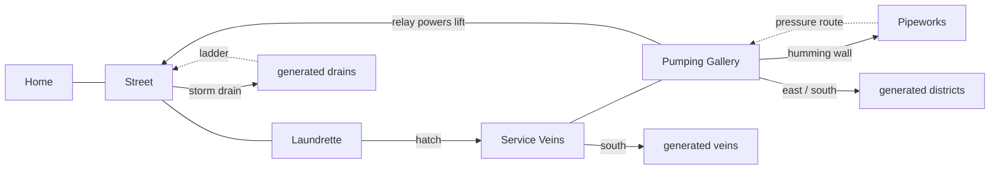
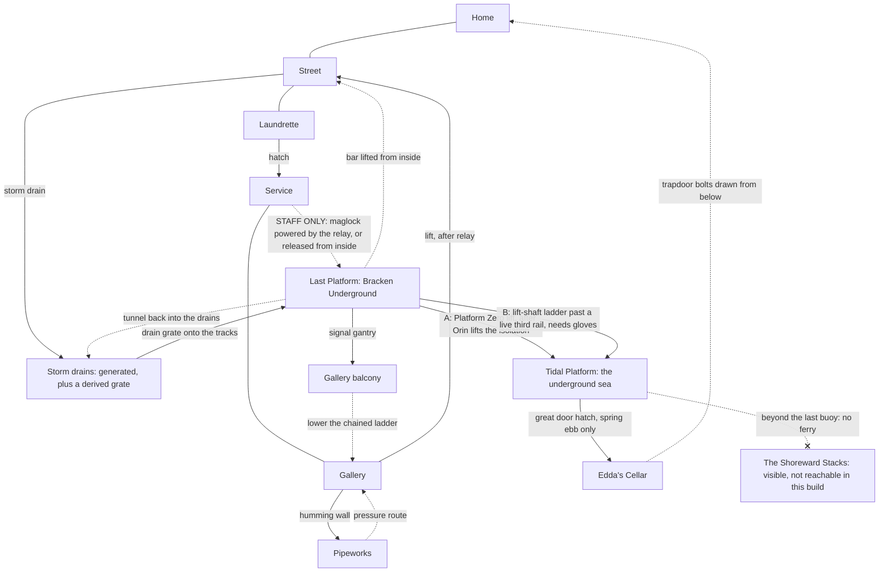

# World structure: why it felt linear, and the network that replaces it

## 1. Diagnosis of the M0–M3 build

| Cause | Where it showed | Effect |
|---|---|---|
| **Instructional information** | Mara's first call named the place ("under the laundrette"), the route ("follow the amber cable markings") and the action ("reconnect it"). The shelf card said exactly how to open the hatch. The relay call said "the lift runs to the street now, go home". Journal entries were quest steps. The pause screen restated the next step. | The player never had to *notice* anything. |
| **A single critical chain** | home → street → yard → laundrette → hatch → Service Veins → gallery → relay → lift → home. Each authored region had exactly one way in from the previous one. | Nothing to choose. The world was a corridor with rooms. |
| **Branches were small loot stubs** | The only authored branch was the humming wall: a good secret, but only one room deep. | Optional paths read as "a chest after thirty seconds". |
| **Visible things with no payoff** | The gallery balcony was visible but connected to nothing. | A promise the world did not keep. |
| **Generated frontier had breadth but no purpose** | Districts branched deeper but never reconnected to known places, and nothing in the authored world pointed into them. | Exploration without investigation: more corridors, not more meaning. |
| **No change of scale** | Every place was a tunnel of human-sized rooms. | "Deeper" could only mean darker. |

## 2. Route graph before this pass

## 3. Route graph now (all of this is playable)

Solid arrows are first-time routes. Dotted arrows open from the far side and become shortcuts. The loop closes: from the bed you woke up in you can now reach the bottom of the sea and back, by at least three different routes.

### How each new connection works

| Connection | Kind of gate | What the player sees first | How it opens |
|---|---|---|---|
| Street ↔ Bracken Underground | opened from the far side | A boarded entrance in cracked tiles reading BRACKEN UNDERGROUND. Inspecting it says the bar is on the inside. | Lift the bar in the ticket hall. |
| Service Veins ↔ station staff door | environmental (power) **or** far side | A STAFF ONLY door with a dark maglock lamp. Trying it explains that nothing is powering the lock. | Reconnecting the relay powers the lock (the lamp turns green), or pull the manual release inside the station. |
| Storm drains → station tracks | maintenance route | In the first storm-drain district, water drifts toward a lit grate. Beneath it: rails. | Climb down. It's the early, dangerous way in. |
| Station ↔ gallery balcony | far side | The balcony you've seen from the gallery since the start, with a ladder chained up out of reach. | Walk the signal gantry onto the balcony, then lower the ladder. |
| Station → Tidal Platform | **social** (A) or **tool + danger** (B) | A dead lift with a lattice gate, a SECTION 9 ISOLATED call panel, an announcement saying "apply to the signal cabin", and a live third rail by a shaft hatch. | **A:** persuade Orin Vale. The evidence that works is Mara's voice on his radio (after the relay) or Edda's signed rota (Cistern Hall storeroom). **B:** disconnect the live third rail with insulated gloves and climb the dark shaft past Lamp Leeches. |
| Tidal Platform → Edda's Cellar | environmental (tide) | A door too big to see the top of, with a hatch cut into its foot, across water. A line of glowing crabs sits under the water. | Wait for the spring ebb (every third low tide) and walk the causeway. |
| Cellar → Home | far side | A trapdoor in your own floor, bolted from below. It's visible from the very first room. | Draw the bolts in the cellar. |

## 4. The representative investigation: why won't the Platform Zero lift run?

| Clue | Where | How it's received |
|---|---|---|
| "Platform Zero services are suspended. Section 9 is isolated. Apply to the signal cabin." | Station PA, every 40 s | Chime, a subtitle, and the departure board reading `0 SUSPEND` |
| "SECTION 9 ISOLATED" | Lift call panel | Read with the interact button |
| Orin refuses a stranger. He'd lift it for someone on his rota, or if the gallery ever called again. | Signal cabin | Conversation |
| Duty rota: E. VALE on every night shift | Signal cabin wall | Read |
| Radio tuned to VEIN-4, the gallery relay's call sign | Signal cabin desk | Listen |
| A live third rail guarding a shaft hatch | End of the track | Seen; trying it explains it |

**Approaches and their consequences:**
- **A1 (social, via the main story).** Reconnect the relay, then talk to Orin. Mara reaches him on the radio and he lifts the isolation. The station is powered: lights, a live departure board, and the lift both ways.
- **A2 (social, via an optional find).** Bring Edda's signed rota from behind the Cistern Hall's live junction. Orin recognises her hand and lifts the isolation, even if the relay is still dead.
- **B (tool and danger).** Use the gloves on the third rail and climb the shaft. You reach the sea early, but the lift stays dead from both ends and the station stays dark. If you talk to Orin later, he calls it nerve, not a reason.

No clue sits behind the gate it opens. Every clue above is on the station side. The rota card and the gloves are both found outside the station.

## 5. One local rule per new region

| Region | Rule | Introduced safely | Demonstrated | Applied |
|---|---|---|---|---|
| Last Platform | **Power is visible.** Dark lamps mean unpowered and green means live. Isolation is a human decision. | The STAFF ONLY maglock lamp in the familiar Service Veins: dark, with an explanation. | Inside the station, the lift, call panel and departure board are all dead and red, and the PA tells you who controls them. | Decide how to get power (the relay, or a reason Orin will accept) or go around it (the rail). |
| Tidal Platform | **The tide.** Every low tide exposes the shoals; every third ebb drains the causeway. A bell rings 6 s before the water turns. The sea never drowns you: it carries you back to the shingle. | The shore has no creatures near the water. The gauge and bell plaque stand by the first shoal, and the first shoal is short. | Nemi explains the third ebb. The gauge's chalk tally counts ebbs. The crabs sit in a line under the water exactly where the causeway runs. | Time the walk to the great door on a spring ebb. The exposed causeway also holds a find (the spare bell clapper). |

## 6. The strange region: the Tidal Platform

**What changes:**
- **Scale.** Steps cut for something enormous, with a narrow human stair cut straight down through them. A door too tall to see the top of, with a person-sized hatch added "much later, by hand".
- **Architecture.** A tiled railway platform ends at a beach.
- **Ecology.** Lantern crabs, glowing growth, drifting spores.
- **Spatial relationships.** A train carriage lies drowned in the sea. The great door turns out to be the back of the house you started in.
- **The apparent purpose of places.** The "station" is a pier; the door predates the town.

**The spectacle.** On reaching the shore, the camera looks out across the water to the **Shoreward Stacks**: a lit town stacked on itself, higher than the cavern should allow, with a light moving between the windows. It is honest about access. Buoys mark END OF SURVEYED WATER, Nemi says the ferry has not run since Section 9 was isolated, and the journal's last hint for that question says plainly that the crossing is not in this build.

**Scale evidence for the Upper Habitat reveal, kept subtle:**
- the giant steps and door
- "far higher than this cavern should allow"
- Edda's letter: "The door was here before Bracken. We built the town on top of it and forgot."
- earlier curios: the survey peg at −1,904 m "and counting", and the compass that points down

Nothing names or shows the reveal.

## 7. Discoveries at every scale (this pass)

| Scale | Example |
|---|---|
| Detail | The chalk tally by the tide gauge. The single mosaic **0** in the platform floor. The pencil note on Orin's radio. |
| Concealed room | Edda's cellar, behind the great door's hatch. |
| Unexpected connection | The cellar stair comes up in your own house. The station gantry reaches the balcony you could only look at. The drains reach the old line. |
| Character | Orin Vale (the signalman holding the isolation). Nemi (the pier hand with undelivered parcels). |
| New use of equipment | The insulated gloves on the station's third rail. |
| Long investigation | Platform Zero (section 4). |
| Unknown region | The underground sea. |
| Hidden boss | None new in this pass. The Pipekeeper remains the optional boss. |

Every find is persistent and placed by hand. None depends on a low-probability roll.

## 8. Orientation

- **Landmarks recur from new angles.** The balcony is seen from below, then from above. The great door is seen from the shore, then from the causeway. Your home appears from the street, then from beneath.
- **Signs.** BRACKEN roundels, the departure board, and a STAFF ONLY door marked with a no-entry roundel (its label says STAFF ONLY).
- **The network map** in the ticket hall charts the whole station on your map and draws the line down to the water.
- **The map signs every known exit with where it leads** ("→ Tidal Platform"), and keeps a pulsing **?** on exits you haven't taken.
- **Reliable return routes.** The Platform Zero lift (route A) runs both ways. The street entrance, the staff door, the ladder and the trapdoor are all two-way once opened. The signal cabin is a refuge.

## 9. Future ideas (not implemented)

- The ferry to the Shoreward Stacks, and the contrast between human and colossal scale inside them.
- Last Platform's other branches: the timetable lists destinations that do not exist yet.
- A hidden tide boss tied to the deepest ebb.
- More generated districts linking back into authored regions beyond the single drain grate (the mechanism in ADR-14 supports more).
- What lies behind the great door's larger leaves.
